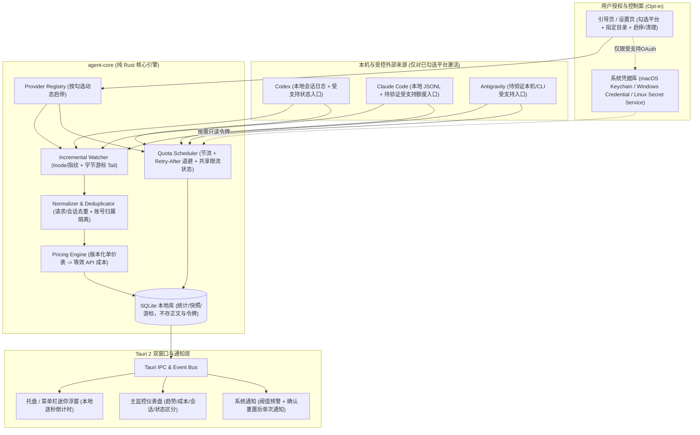
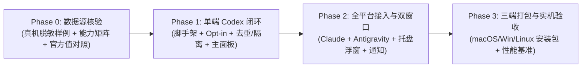

# 本机 AI Agent Token 用量与配额监控软件 — 开发与验收规格书（完整修订稿）

> **定位**：一款**免注册、纯本地统计、可控联网**的跨平台桌面监控软件（交付 **macOS / Windows / Linux** 三端原生安装包）。采用 **Tauri 2 + Rust + React + TypeScript + SQLite**，提供**系统托盘/菜单栏迷你浮窗**与**完整监控主面板**双窗口体验，首批覆盖 **OpenAI Codex**、**Claude Code** 与 **Google Antigravity**。

> [!IMPORTANT]
> **事实与验证口径声明**：本文档严格区分三类信息状态——**「官方有说明」**（附官方文档链接）、**「指定版本已实测」**（已于 `macOS 26.5.2 arm64` 完成首轮脱敏样例核验，详见 [phase0_verification_report.md](phase0_verification_report.md)）与**「待验证」**（尚未实机核对或待官方同屏显示值对照）。任何「待验证」能力均不得提前承诺为首版必然可用功能。

---

## 1. 产品形态、首次引导与账号绑定流程

### 1.1 双窗口桌面形态
1. **系统托盘 / 菜单栏迷你浮窗（随时瞄一眼）**
   - 常驻后台，支持开机自启；点击托盘/菜单栏图标展开紧凑浮窗。
   - 展示已勾选平台的当前账号、配额进度条、预计重置倒计时、数据来源时间与快捷刷新入口；支持一键打开主面板。
2. **完整监控主仪表盘（趋势、成本与实时会话）**
   - **平台总览卡片**：按平台与账号隔离展示 Token 用量、配额窗口/模型池、重置倒计时、状态标识（正常 / 缓存 / 离线 / 限流 / 来源不可用）。
   - **实时会话视图**：展示活跃会话的目录、模型、单次与累计 Token、最近落盘时间。
   - **趋势与成本分析**：按小时 / 日 / 周 / 月、模型与项目目录拆解，并展示带口径说明的等效 API 成本。
   - **通知中心与设置页**：配额阈值提醒（如 80% / 95%）、配额确认恢复通知、平台启停与数据生命周期管理。

### 1.2 首次自动全量探测、按需重扫与平台勾选（严格 Opt-in）
- **监控软件本身免注册**，无需创建自有账号。
- **首次打开自动全量轻量扫描（One-shot Discovery）**：
  - 自动对注册表中的全部 Agent 执行一次只读存在性扫描（覆盖 **Codex、Claude Code、Antigravity**，以及后续扩展的 **Cursor、Gemini CLI、OpenCode、Aider 及国产大模型/编码 Agent 生态**如 **DeepSeek 桌面端**、Trae、Qwen Code、Kimi CLI 等）。
  - 扫描仅检查默认目录、应用包与可执行文件存在性，**不读取对话正文、不发起联网请求、不触发任何限流**。
  - 架构上将 **「发现探测器（`AgentDetector`，声明式轻量规则）」** 与 **「数据采集适配器（`ProviderAdapter`）」** 解耦，逐项标明状态：
    - `已检测到`（发现客户端与本地数据目录）
    - `仅发现历史日志`（本机无客户端，但存在可读历史日志，如卸载后的 `~/.claude/projects`）
    - `已检测到 · 适配开发中`（已识别出本机装有其他/国产 Agent，但对应采集适配器尚未接入，不假装支持监控）
    - `需要指定目录`（高阶兜底：自定义数据目录或 Windows 下 WSL 路径）
    - `未检测到`（默认折叠收起，不占首屏）
- **引导页确认勾选（Opt-in）**：每个可监控平台旁展示简要能力预览（能看什么、是否联网、当前支持范围）。**用户主动勾选并点击「确认启用」后**，后台才开始对所选平台启动日志监听、状态检查或通知；未勾选平台保持完全静默。
- **平时不反复扫描 + 一键「重新扫描」按钮（On-Demand Rescan）**：
  - 日常后台**绝不持续反复扫全盘**，保持空闲零额外资源开销。
  - 当用户日后新安装了此前未检测到的 Agent 时，无需手动添加配置，只需在主面板或设置页点击 **「重新扫描本机 Agent」**，即可按需跑一遍轻量探测并高亮提示新发现的 Agent 供一键勾选启用。设置页仍可随时增删平台或调整自定义目录。

### 1.3 两种账号使用方式与 Antigravity 边界
| 账号使用方式 | 适用条件 | 约束规则 |
| :--- | :--- | :--- |
| **使用本机当前账号**（默认优先） | 官方客户端已在本地登录，且本地受支持的数据来源能够确认当前账号归属 | 仅做只读检测与受支持查询；不要求用户在监控软件内重复登录；不修改或刷新原客户端凭证 |
| **绑定其他账号**（按需开放） | 仅当平台官方提供受支持的授权方式，且该授权**确实具备查询用量或配额的权限**时才开放 | 通过系统浏览器打开官方授权页完成 OAuth，仅申请查询所需最小权限，令牌存入系统凭据库 |

- **Antigravity 专项边界**：
  - 明确区分 **「Google 身份登录（OIDC 身份认证，仅获取邮箱/基础资料）」** 与 **「读取 Antigravity 用量及配额」** 所需的能力与授权。
  - 若某授权方式仅能获取 Google 邮箱而不能合法查询 Antigravity 额度，**严禁展示「额度绑定成功」**，也不应要求用户为了查看本机数据而登录 Google 账号。

### 1.4 停止监控、解除授权与数据清除（独立生命周期）
用户取消勾选某平台时，后台**立即停止**该平台的文件监听、定时轮询与桌面通知。设置页针对每个平台分别提供三个互不耦合的操作：
1. **停止监控**：暂停采集与通知，保留 SQLite 中的历史统计数据，随时可重新启用。
2. **解除授权**：仅对启用了在线授权的平台生效，吊销并从操作系统凭据库删除该平台令牌（同时停止在线查询，保留历史记录）。
3. **删除本地历史**：彻底清除 SQLite 中该平台对应的用量记录、配额快照、文件游标与账号元数据（操作前二次确认）。

---

## 2. 技术栈与系统架构

### 2.1 技术栈与跨平台交付目标
- **桌面壳**：**Tauri 2**（`tray-icon`、双窗口 `popover` + `dashboard`、`tauri-plugin-autostart`、`tauri-plugin-notification`、`tauri-plugin-positioner`）。
- **核心引擎**：独立纯 Rust Crate `agent-core`（`tokio`、`notify`、`rusqlite`、`sysinfo`、`keyring`、`serde`），可脱离 GUI 独立跑单测与离线 fixture 核对。
- **前端**：**React 19 + TypeScript + Vite + Tailwind CSS + Zustand + Recharts/ECharts**。
- **三端安装包**：GitHub Actions（`tauri-apps/tauri-action`）构建 macOS（`.dmg`/`.app`，Apple Silicon + Intel）、Windows（`.msi`/`.exe`）、Linux（`.AppImage`/`.deb`/`.rpm`）。
- **跨端兼容策略**：Linux（尤其 Wayland）无法获取托盘坐标时浮窗回退至屏幕右上角/居中贴边；采用高对比实底分层卡片避免 WebKitGTK 毛玻璃渲染差异。

### 2.2 更新后的系统架构图



---

## 3. Phase 0：数据源逐项验证与能力矩阵（开发准入门禁）

在进入任何正式适配器开发（Phase 1）之前，必须先完成 **Phase 0 真机核验**。

### 3.1 Phase 0 验证清单与交付物

| 平台 | Phase 0 优先验证内容 | 明确约束与禁忌 |
| :--- | :--- | :--- |
| **Codex** | 1. 采集脱敏 session JSONL 样例，核对单次请求用量、会话累计用量与 `rate_limits` 快照字段。<br>2. 验证账号标识、套餐与额度窗口的官方受支持来源。<br>3. 验证在**没有新会话产生时**，能否通过官方受支持入口主动获取新快照。 | 优先使用官方支持的账号状态入口；**避免为了展示账号去解析凭证文件**。 |
| **Claude Code** | 1. 采集脱敏 JSONL 样例，核对同一请求在流式/多步过程中产生的多条记录、缓存字段（`cache_read` / `cache_creation`）与最终用量口径。<br>2. 单独验证 `/usage`（及 `/statusline` 等官方入口）是否存在受支持的非交互读取方式。 | **已删除「根据本机首条 prompt 推算账号 5 小时重置时间」的默认方案**（因官方说明额度跨 claude.ai / Claude Desktop / Claude Code 共享，本机首条记录不可靠）。 |
| **Antigravity** | 1. 逐项核实账号、模型池、剩余额度、重置时间与 Token 明细的受支持来源。<br>2. 对原稿提及的本机 Language Server、CLI `/usage`、`/quota`（及 `/statusline`）逐一核查适用客户端、版本号及非交互可读性。 | **本机存在进程或监听端口不能证明第三方获得了查询授权**；查不到或无授权的字段允许缺省，不得用非授权接口绕过。 |

**Phase 0 必交产出物（3 项齐备才可进入 Phase 1）**：
1. 更新为「指定版本已实测」的**实测能力矩阵**（含精确客户端版本号与操作系统环境）。
2. 三个平台的**脱敏真机样例集（Fixtures）**（不含任何 prompt、回复正文、邮箱原文或令牌），直接沉淀为 `agent-core` 单元测试资产。
3. **官方客户端显示值对照报告**：将本工具解析结果与官方 CLI / IDE 同屏显示的用量、百分比、重置时间逐字段核对，记录误差与缺失项。

### 3.2 能力矩阵（已同步 macOS `26.5.2 arm64` Phase 0a 实测结果）

> 状态标记说明：`官方有说明` = 官方文档明确描述该能力；`指定版本已实测` = 已在真机通过脱敏样例核验字段结构与口径（详见 [phase0_verification_report.md](phase0_verification_report.md)）；`待验证` = 尚未完成实机读取或官方同屏数值对照。

| 平台 | 能力项 | 候选数据来源 | 适用客户端与版本 | 是否需要登录 | 是否会联网 | 验证状态与参考 |
| :--- | :--- | :--- | :--- | :--- | :--- | :--- |
| **Codex** | 本次请求 Token | 本地 session JSONL `token_usage_record`（去重键 `session_id + response_id`，按 `turn_id` 关联 `turn_context.model`） | `codex-cli 0.154.0`（macOS arm64） | 否（读本机已有日志） | 否 | **指定版本已实测**（确认 `cached_input` 含于 `input`、`reasoning_output` 含于 `output`；绝不与 `event_msg:token_count` 重复累加） |
| **Codex** | 累计 Token | session JSONL `event_msg:token_count.info.total_token_usage` 或按 `token_usage_record` 聚合 | `codex-cli 0.154.0`（macOS arm64） | 否（读日志） | 否 | **指定版本已实测**（日志结构）；**官方有说明**（[Codex CLI 命令参考](https://learn.chatgpt.com/docs/developer-commands)）；同屏对照 **待验证** |
| **Codex** | 当前账号 | app-server `account/read` | `codex-cli 0.154.0`（macOS arm64） | 需官方客户端已登录 | 经本机 CLI | **指定版本已实测** |
| **Codex** | 套餐（Plan） | session JSONL `rate_limits.plan_type` | `codex-cli 0.154.0`（macOS arm64） | 需官方客户端已登录 | 否（读日志） | **指定版本已实测**（样例值 `plus`） |
| **Codex** | 额度百分比 | session JSONL `rate_limits.primary` / `secondary.used_percent`（按 `window_minutes` 动态区分 300=5h / 10080=7d） | `codex-cli 0.154.0`（macOS arm64） | 需官方客户端已登录 | 读日志否 / 主动查询是 | **指定版本已实测**（日志结构，且证实 `primary` 可能直接是 10080 分钟周窗口）；主动查询已用 16% 与官方剩余 84% **已核对** |
| **Codex** | 重置时间 | session JSONL `rate_limits.*.resets_at`（Unix 秒级时间戳） | `codex-cli 0.154.0`（macOS arm64） | 需官方客户端已登录 | 读日志否 / 主动查询是 | **指定版本已实测**（日志结构）；官方同屏重置时间已核对至分钟 |
| **Codex** | 主动刷新能力 | app-server `account/rateLimits/read` | `codex-cli 0.154.0`（macOS arm64） | 需官方客户端已登录 | 是 | **指定版本已实测**，无需发起模型请求 |
| **Claude Code** | 本次请求 Token | 本地 JSONL `~/.claude/projects/**/*.jsonl` 的 `assistant` 记录（去重键 `sessionId + message.id`） | Claude Code `2.1.278`（macOS arm64，本机未在默认 PATH） | 否（读本机已有日志） | 否 | **指定版本已实测**（证实同一回复会写 2–3 条不同 `uuid` 但同 `message.id` 的记录；且 `cache_read` / `cache_creation` **不含于** `input_tokens`；需兼容第三方模型路由） |
| **Claude Code** | 累计 Token | 本地 JSONL 去重汇总 / 官方 `/usage` 命令 | Claude Code `2.1.278` | 否（读日志）/ 需官方 CLI 已登录 | 否（读日志） | **指定版本已实测**（JSONL 去重汇总）；**官方有说明**（[Claude Code Costs & `/usage`](https://code.claude.com/docs/en/costs)）；`cost-state` 字段 **待验证** |
| **Claude Code** | 当前账号 | 官方受支持状态命令 / 本地非敏感配置 | Claude Code `2.1.278` | 需官方客户端已登录 | 待验证 | **官方有说明**认证机制（[Authentication](https://code.claude.com/docs/en/authentication)）；非交互读取 **待验证** |
| **Claude Code** | 套餐（Plan） | 官方状态输出 / `/usage` | Claude Code `2.1.278` | 需官方客户端已登录 | 待验证 | **待验证** |
| **Claude Code** | 额度百分比 | 官方 `/usage`（待核验非交互方式） | Claude Code `2.1.278` | 需官方客户端已登录 | 是 | **官方有说明**存在 5h 与周限额且跨端共享（[Usage Limits](https://support.claude.com/en/articles/11647753-how-do-usage-and-length-limits-work)、[Paid Plans Reset](https://support.claude.com/en/articles/12429409-manage-usage-credits-for-paid-claude-plans)）；非交互读取 **待验证** |
| **Claude Code** | 重置时间 | 官方 `/usage`（不采用本机首条 prompt 推算） | Claude Code `2.1.278` | 需官方客户端已登录 | 是 | **待验证** |
| **Claude Code** | 主动刷新能力 | 受支持的非交互 CLI 查询（遵守限流） | Claude Code `2.1.278` | 需官方客户端已登录 | 是 | **待验证**（需确认无高频 429 副作用） |
| **Antigravity** | 本次请求 Token | 本机受支持状态/日志（如 `/statusline` payload 或本地统计） | Antigravity Desktop `2.35.1`（`com.google.antigravity`，默认 PATH 无 CLI） | 待验证 | 否 | **待验证**（允许缺省） |
| **Antigravity** | 累计 Token | 本机受支持状态/日志或官方命令 | Antigravity Desktop `2.35.1` | 待验证 | 待验证 | **待验证**（允许缺省） |
| **Antigravity** | 当前账号 | 官方受支持 CLI 状态 / IDE 受授权入口 | Antigravity Desktop `2.35.1` | 需官方客户端已登录 | 待验证 | **待验证** |
| **Antigravity** | 套餐（Plan） | 官方受支持 CLI `/usage` / `/credits` | Antigravity Desktop `2.35.1` | 需官方客户端已登录 | 待验证 | **官方有说明**存在 `/credits` 与 `/usage`（[Antigravity `/credits`](https://antigravity.google/docs/cli/commands/credits/)）；非交互输出 **待验证** |
| **Antigravity** | 额度百分比 | 官方 CLI `/usage`（别名 `/quota`）按模型池展示；已确认本机存在 `language_server` 进程与 `Application Support/Antigravity/bin`，但尚未确认第三方查询授权 | Antigravity Desktop `2.35.1` | 需官方客户端已登录 | 是（或经官方本地进程同步） | **官方有说明**交互命令（[Antigravity `/usage`](https://antigravity.google/docs/cli/commands/usage/)、[Antigravity `/statusline`](https://antigravity.google/docs/cli/commands/statusline/)）；非交互与授权边界 **待验证** |
| **Antigravity** | 重置时间 | 官方 CLI `/usage`（按模型池独立重置时间） | Antigravity Desktop `2.35.1` | 需官方客户端已登录 | 同上 | **待验证** |
| **Antigravity** | 主动刷新能力 | 受支持的官方 CLI 查询或受控本地状态读取 | Antigravity Desktop `2.35.1` | 需官方客户端已登录 | 是 | **待验证** |

---

## 4. 「实时查询」产品行为与时间语义规范

### 4.1 关键事件与界面响应规范

| 用户操作或事件 | 面板与托盘应有的明确行为 |
| :--- | :--- |
| **打开软件** | 立即渲染 SQLite 中已有快照及其原始来源时间（零白屏等待）；同时在后台对**已勾选平台**并发触发当前可用的刷新操作。 |
| **Agent 完成一次请求** | 以完整用量记录落盘为起点，目标 **2 秒内**完成增量解析、去重入库并推送更新至界面。若某 Agent 仅在回复结束后才写入统计，则等待记录落盘后再显示真实值，不展示伪造过程值。 |
| **点击「立即刷新」** | 支持主动查询的平台发起一次受控查询；仅支持本地快照的平台重新读取最新本地文件/快照。若读到的仍是同一条旧记录，界面提示 **「暂无新数据」** 并**严格保留原始来源时间**，不得把旧数据时间改写为当前点击时间。 |
| **配额倒计时归零** | 倒计时归零后**不得直接判定已恢复**；界面改为显示 **「已到预计重置时间，等待确认」**。仅当后续收到新窗口数据或官方明确的恢复状态时，才更新进度条并发送重置恢复通知；**同一重置窗口最多通知一次**。 |
| **断网、客户端退出或遇到 429** | 保留最近一次成功快照及其原始时间，不清空页面。界面明确区分三类异常态：**「离线」**、**「来源不可用」**（如客户端未运行/目录不可访问）、**「限流中」**（显示冷却倒计时）。严格遵守服务端返回的重试时间（如 `Retry-After`），**手动点击「立即刷新」同样受同一限流退避状态机约束**，不得绕过限流强刷。 |

### 4.2 三时间字段语义与倒计时规则
所有配额快照与状态展示必须严格区分以下三个时间：
1. **`source_timestamp`（来源产生时间）**：数据实际由上游或日志文件生成的时刻。若数据源未提供该时间戳，界面明确显示 **「数据时间未知」**，绝不用本机读取时间冒充。
2. **`checked_at`（最近检查时间）**：本监控软件最近一次尝试读取或查询的时刻。
3. **`resets_at`（预计重置时间）**：上游给出的窗口重置绝对时间（UTC 存储、按本机时区展示）。

- **展示示例**：用户 14:10 点击刷新，但仅读到 14:00 产生的快照 → 界面展示 **「额度数据截至 14:00，14:10 已检查」**。
- **倒计时计算**：逐秒/逐分钟倒计时完全由前端根据 `resets_at - now()` 在本地计算渲染，**无需每秒联网**。

---

## 5. 数据模型、账号归属与计量口径

### 5.1 账号归属与隔离规则
- 为每个可确认归属的账号生成稳定的本地标识 **`account_key`**（由 `provider_id` + 平台稳定账号 ID 经本地规范化生成），所有用量记录与配额快照均按 `(provider_id, account_key, source_id)` 关联。
- 脱敏邮箱或昵称（`display_label`，如 `k***@gmail.com`）**仅用于界面展示**，不得作为数据库外键或去重依据。
- 无法确认账号归属的历史或离线记录，必须归入独立的 **`unattributed`（「本机已记录用量 · 归属未知」）** 分组，**严禁自动归并到当前登录账号名下**。

### 5.2 Token 计数语义、去重与空值规则
- **Adapter 计量契约**：每个 Provider Adapter 必须显式声明：
  - `value_mode`：原始记录为单次增量（`delta`）还是会话累计（`cumulative`）；
  - `inclusion_policy`：`cache_read`、`cache_write`、`reasoning` Token 是否已包含在 `input` 或 `output` 字段内，归一化层据此避免重复统计。
- **幂等去重机制**：
  - 支持**同一请求多次更新**（按 `(provider_id, session_id, request_or_turn_id)` 执行 Upsert，取最终落盘值）；
  - 支持**同一会话重复导入**、**日志轮转（结合文件 inode / 首块指纹 + 字节游标）**与**程序异常重启**后的严格不重不漏。
- **空值与零值严格分离**：缺失或上游未提供的字段存储为 `NULL`，界面显示 **`—`**（未知/未提供）；仅当上游明确给出 `0` 时才显示 `0`。绝不把未知值显示为 `0`、`100%` 或「无限」。

### 5.3 配额、耗尽预估（Runway）与成本口径
- **多窗口 / 多模型池配额**：单账号支持同时挂载多个 `QuotaWindow`（如 `5h_session`、`weekly`、`pool_gemini_pro`、`pool_claude`），每个窗口独立记录 `metric_kind`（`used_percent` | `remaining_percent`）、`scope`、`source_timestamp`、`checked_at`、`resets_at`、`status`。缺少总额度时仅展示来源给出的比例，不反推总额。
- **禁止非法聚合**：不同账号、不同模型池、不同计量单位的配额百分比**禁止直接相加或求平均**。
- **配额耗尽预估（Runway）**：仅在**同一额度窗口内积累了足够数量的可比配额观测点**（例如 `>= 3` 个有效非平稳快照且时间跨度足够）时才计算展示；明确本机测得的 **`tokens/min` 无法直接换算为订阅制额度百分比**。
- **等效 API 成本估算**：采用独立版本化价目表（记录 `pricing_version` 与币种 `USD`），界面明确标注为 **「等效 API 成本（仅供参考）」**；未命中可靠单价的模型对应成本存 `NULL` 留空展示，且不按 `$0` 混入已估算总额。

### 5.4 核心 SQLite 实体模型（逻辑 Schema）

```text
providers_config (
  provider_id PK, enabled, custom_data_dir, auth_mode,
  last_checked_at, rate_limit_until, status, updated_at
)

accounts (
  account_key PK, provider_id, is_unattributed, display_label,
  plan_tier, last_seen_at
)

usage_records (
  record_uid PK,              -- 幂等去重键: hash(provider_id, session_id, turn_or_request_id)
  provider_id, account_key, source_id, session_id, project_path, model,
  input_tokens NULL, output_tokens NULL,
  cache_read_tokens NULL, cache_write_tokens NULL, reasoning_tokens NULL,
  estimated_cost_usd NULL, pricing_version NULL,
  source_timestamp NULL, ingested_at
)

quota_snapshots (
  snapshot_id PK, provider_id, account_key, window_id, scope_label,
  metric_kind, percent_value NULL,
  source_timestamp NULL, checked_at, resets_at NULL,
  freshness_state,            -- exact | stale | awaiting_reset_confirm | rate_limited | unavailable
  reset_notified_for_window   -- 防止同一窗口重复通知
)

file_cursors (
  source_path PK, provider_id, file_identity, byte_offset, last_mtime
)
```

---

## 6. 「本地运行」与账号权限安全边界

- **本地执行边界**：文件监听、日志解析、去重聚合、SQLite 持久化、本地倒计时与 UI 渲染 100% 在用户设备上运行，不设立任何开发者侧中转服务器。
- **联网透明披露**：若某平台启用官方在线额度查询，须在引导勾选页和设置页明确告知用户**「该平台会联网」**以及**「仅向官方端点查询额度/状态，不上传本地对话或代码」**。
- **凭据与隐私隔离**：
  - 仅在受支持且确有查询能力时提供 OAuth，且必须通过**系统浏览器 + 官方授权页**完成，只申请最小只读 Scope。
  - 需保存的授权令牌统一存入**操作系统凭据库**（macOS Keychain / Windows Credential Manager / Linux Secret Service）；SQLite 仅保存统计指标与必要元数据。
  - 解析会话日志采用流式逐行提取，**绝不持久化 prompt、回复正文、Cookie 或完整原始日志**。
- **组织级高权限密钥隔离**：若某平台用量查询依赖高权限组织管理员密钥（Organization Admin Key），不纳入个人本机默认流程，而是作为独立的「组织用量场景」在后续版本单独评估。

---

## 7. 仓库目录结构与开发路线图

### 7.1 建议仓库目录（`kitty191/agent_use`）

```text
agent_use/
├── Cargo.toml                        # Rust Workspace
├── crates/
│   └── agent-core/                   # 纯 Rust 引擎（可独立单测与 CLI 调试）
│       ├── src/
│       │   ├── models/               # Account / QuotaSnapshot / UsageRecord / TimeSemantics
│       │   ├── providers/            # ProviderAdapter Trait + Codex / Claude / Antigravity
│       │   ├── watcher/              # 增量 Tail + 文件指纹 + 游标管理
│       │   ├── dedup/                # 请求 Upsert / 轮转去重 / 账号归属隔离
│       │   ├── scheduler/            # 限流状态机（手动与自动共享 Retry-After）
│       │   ├── pricing/              # 版本化模型单价表（等效 API 成本）
│       │   └── storage/              # SQLite Schema、迁移与安全清理
│       └── tests/fixtures/           # Phase 0 脱敏真机样例与核对测试
├── src-tauri/                        # Tauri 2 桌面层（托盘、双窗口、系统凭据、通知）
├── src/                              # React 19 + TS 前端（popover 浮窗 + dashboard 主面板）
└── .github/workflows/release.yml     # macOS / Windows / Linux 三端构建流水线
```

### 7.2 调整后的分阶段路线图



1. **Phase 0（数据核验门禁）**：完成 Codex / Claude Code / Antigravity 真机核验、脱敏样例采集与官方显示值对照，锁定各平台实际可用字段与缺省项。
2. **Phase 1（单目标系统先跑通 Codex 全流程）**：
   - 先在单一主开发系统上搭建 Tauri 2 + `agent-core` + React + SQLite 脚手架。
   - 完整实现首次勾选引导、设置页启停/清理、Codex 增量监听、幂等去重、账号归属隔离、三时间语义与限流状态机、主仪表盘首版。
3. **Phase 2（接入 Claude Code 与 Antigravity + 托盘双窗口）**：
   - 基于 Phase 0 结论接入 Claude Code 与 Antigravity Adapter（缺省项优雅降级）。
   - 完善托盘/菜单栏迷你浮窗、开机自启、趋势图、等效 API 成本拆解、阈值预警与确认重置后的单次通知。
4. **Phase 3（三端打包、WSL 适配与性能/功能验收）**：
   - 打通 GitHub Actions 三平台构建（macOS / Windows / Linux）并完成全量验收测试。

---

## 8. 性能目标、平台/WSL 支持矩阵与首版验收标准

### 8.1 性能目标与三态基准测量
保留轻量化目标作为**性能验收基线**，并在三种工况下分别测量记录（避免只测空闲值）：

| 测量工况 | 内存目标 | CPU 目标 | 补充指标 |
| :--- | :--- | :--- | :--- |
| **1. 后台空闲**（托盘常驻、无活跃写入） | `30–60 MB` | `< 1%` | 零无谓磁盘写入与零高频轮询 |
| **2. 首次扫描大日志**（如 `>= 500 MB` 历史 JSONL） | 峰值可控（流式解析不整文件加载） | 短时可控、不阻塞 UI 渲染 | 展示扫描进度，支持中断与续扫 |
| **3. 持续增量采集**（多会话并发高频写入） | 稳定无泄漏 | 平均 `< 1%`（突发 `< 5%`） | 完整记录落盘后 **2 秒内**更新界面 |
| **安装包体积** | — | — | 三端基准目标 `10–15 MB`（按实际打包值记录） |

### 8.2 Windows 原生与 WSL 运行环境支持说明

| 运行环境 | 首版支持定位 | 说明 |
| :--- | :--- | :--- |
| **macOS / Linux 原生** | **完整支持** | 直接监听本机默认目录与用户自定义目录 |
| **Windows 原生运行的 Agent** | **完整支持** | 监听 Windows 本地路径与原生进程 |
| **Windows 下 WSL 内运行的 Agent** | **条件支持（需在设置中指定目录，Phase 3 专项验证）** | 跨 `\\wsl$` 路径的文件事件监听在部分 Windows 版本存在通知丢失问题，需针对 WSL 目录启用「事件监听 + 低频校验扫描」混合模式，并在界面标注为 WSL 目录来源 |

### 8.3 首版 6 条硬性验收标准（Release Blocker）

1. **严格按勾选隔离**：仅勾选 Codex 时，通过日志与进程/网络抓包确认 Claude Code 与 Antigravity **零日志监听、零后台查询、零系统通知**。
2. **并发与幂等去重**：同时运行两个会话，新增单次与累计用量与脱敏样例及官方值逐项可核对；关闭主面板后再打开能自动补齐期间记录；重复导入同一日志文件或重启软件后，用量**绝不翻倍**。
3. **账号切换与归属隔离**：从账号 A 切换登录到账号 B 后，账号 A 的历史用量与配额快照不会出现在账号 B 名下；无法确认归属的记录明确归入「本机已记录用量（归属未知）」。
4. **刷新与异常态诚实呈现**：界面能清晰区分「缓存过期」「主动查询成功」「限流中（含冷却时间）」「来源不可用/无法读取额度」；点击「立即刷新」读到旧快照时提示「暂无新数据」且**保留原始来源时间**，绝不把旧快照标成刚刚产生。
5. **部分字段缺省与空值语义**：某平台仅有 Token 用量无额度，或仅有额度无 Token 明细时，软件仍正常可用；所有未知/缺失字段显示 `—`，**绝不显示为 `0`、`100%` 或「无限」**。
6. **离线重置不误报与单次通知**：配额到达预计重置时间且设备处于离线状态时，界面显示「已到预计重置时间，等待确认」，**绝不误报「额度已恢复」**；网络恢复并取得新窗口或官方确认后，才更新进度条并发送通知，且**同一重置窗口仅通知一次**。

---

## 9. 附录：首版能力表（面向用户告知与开发排期）

> 本表可直接用于软件引导页的「勾选前能力说明」，并随 Phase 0 真机核验结果同步更新。

| 平台 | 规划展示字段（缺省项自动留空 `—`） | 用户需要做什么 | 数据更新频率 | 当前仍待 Phase 0 验证的部分 |
| :--- | :--- | :--- | :--- | :--- |
| **OpenAI Codex** | 单次/累计 Token（含缓存与推理拆分）、等效 API 成本、当前账号与套餐、5h/周额度百分比与预计重置倒计时、活跃会话 | 在本机正常使用已登录的 Codex CLI；在监控软件引导页勾选 Codex（如日志在自定义目录或 WSL 则指定目录） | 本地日志落盘后目标 **2 秒内**更新；无新会话时按低频策略或手动刷新检查快照；倒计时本地逐秒更新 | macOS 单次跨终端试验通过（增量 19,618 Token，显示延迟上界 538 ms）；其他系统待测 |
| **Claude Code** | 单次/累计 Token（Input / Output / Cache Read / Cache Write）、等效 API 成本、活跃会话；当前账号、套餐、5h/周额度百分比与重置倒计时（视 Phase 0 结论开放） | 在本机正常使用已登录的 Claude Code；勾选 Claude Code（若启用在线额度检查，软件会明示联网用途） | 本地 JSONL 落盘后目标 **2 秒内**更新；在线额度检查遵循低频节流（活跃 3–5 分钟、空闲 10–15 分钟）与服务端限流退避 | 1. 同一请求多条 JSONL 记录的去重主键与最终值口径；<br>2. `/usage` 或其他官方入口是否存在受支持的非交互读取方式与限流表现；<br>3. 当前账号与套餐的非交互获取方式 |
| **Google Antigravity** | 按模型池拆分的剩余/已用额度百分比与各自重置倒计时、当前账号与套餐；本地 Token 明细（仅在存在受支持来源时展示，否则缺省 `—`） | 在本机正常使用已登录的 Antigravity IDE 或 CLI；勾选 Antigravity（不要求为查看本机数据额外登录 Google） | 受支持查询按低频节流或手动刷新更新；客户端退出/离线时展示上次快照与本地倒计时，到点后等待重新同步确认 | 1. CLI `/usage`（`/quota`）、`/credits`、`/statusline` 的适用版本与非交互可读性；<br>2. 本机 Language Server 是否具备受支持查询边界；<br>3. 是否存在可靠的账号归属与 Token 明细来源 |
